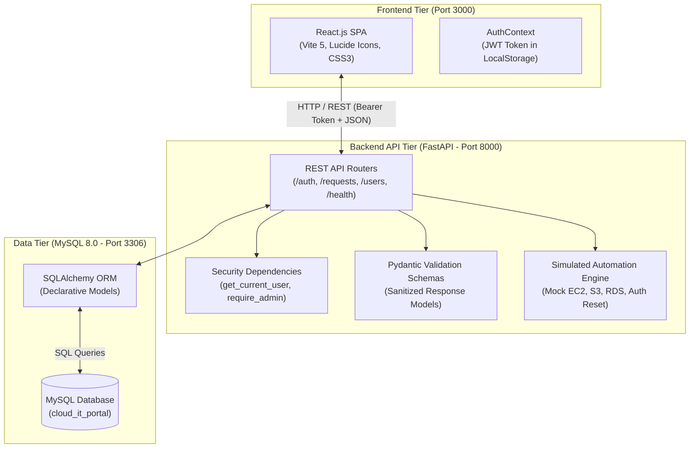

# Cloud-Based IT Service Request & Automation Portal

A full-stack, cloud-ready IT service desk and infrastructure automation portal built with **React.js**, **FastAPI**, and **MySQL**.

This application enables employees to request cloud infrastructure and IT services (Virtual Machines, Cloud Storage permissions, Database accounts, Password resets) and allows IT administrators to trigger automated fulfillment workflows with real-time execution transcripts.

---

## 🌟 Key Features

* **Role-Based Access Control (RBAC)**:
  * **`EMPLOYEE`**: Can submit service requests, track approval status, inspect execution logs, and cancel pending requests. Strict data isolation prevents employees from viewing tickets filed by others.
  * **`ADMIN`**: Organization-wide visibility, user directory access, and exclusive privileges to trigger the simulated cloud automation engine.
* **Stateless JWT Security**:
  * Passwords hashed using `bcrypt` (12 rounds with random salt).
  * Cryptographically signed JSON Web Tokens (`HS256`, 60-minute expiry) attached via `Authorization: Bearer` headers.
* **Simulated IT Infrastructure Automation Engine**:
  * Deterministic Python automation service modeling AWS infrastructure provisioning.
  * Generates mock cloud identifiers (e.g. AWS EC2 Instance ID `i-0a81c72f4e3b1`, S3 bucket ARNs, IAM policies).
  * Records timestamped audit logs with step-by-step execution transcripts at **$0 cloud cost**.
* **Modern, Humanized User Interface**:
  * Built with React 18, Vite 5, and Lucide icons.
  * Human-friendly service explanations, responsive metric cards, glowing status pills, and an interactive dark-themed cloud terminal for log inspection.
* **Cloud-Ready Architecture**:
  * Strict separation of configuration and code via `.env` and `pydantic-settings`.
  * Containerized multi-service foundation using Docker and Docker Compose.
  * Connection pool management with liveness probing (`pool_pre_ping=True`) and recycling.

---

## 🏗️ System Architecture



---

## 📊 Implementation Status Matrix

To maintain complete honesty for portfolio and resume presentations:

| Component | Status | Description |
| :--- | :---: | :--- |
| **User Authentication** | **IMPLEMENTED** | Bcrypt hashing, JWT issuance, `/register`, `/login`, `/me`. |
| **RBAC Authorization** | **IMPLEMENTED** | Endpoint guards enforcing `EMPLOYEE` vs `ADMIN` permissions. |
| **Service Request CRUD** | **IMPLEMENTED** | Ticket creation, filtering, query isolation, deletion. |
| **MySQL Relational Schema** | **IMPLEMENTED** | Relational `users` and `service_requests` with foreign keys. |
| **React Single Page App** | **IMPLEMENTED** | Dashboard, metric cards, request modal, and terminal viewer. |
| **Simulated Automation Engine** | **SIMULATED** | Models AWS provisioning workflows locally without cloud charges. |
| **Docker & Docker Compose** | **CONFIGURED** | `Dockerfile` and `docker-compose.yml` configured and ready. |
| **AWS Cloud Infrastructure** | **PLANNED** | Architectural blueprint for AWS EC2, RDS, S3, IAM, CloudWatch. |

---

## 📁 Repository Structure

```text
cloud-it-service-portal/
├── backend/
│   ├── app/
│   │   ├── config.py              # Environment settings (Pydantic BaseSettings)
│   │   ├── database.py            # SQLAlchemy engine & session factory
│   │   ├── dependencies.py        # JWT Bearer validation & RBAC guards
│   │   ├── main.py                # FastAPI app bootstrap, CORS, router aggregation
│   │   ├── security.py            # Bcrypt hashing & PyJWT token utilities
│   │   ├── models/                # SQLAlchemy database models (User, ServiceRequest)
│   │   ├── routers/               # API controllers (/auth, /requests, /users)
│   │   ├── schemas/               # Pydantic input/output validation schemas
│   │   └── services/              # Simulated IT automation engine
│   ├── .env.example               # Backend environment template
│   ├── Dockerfile                 # Backend container blueprint
│   ├── requirements.txt           # Python dependencies
│   └── venv/                      # Local Python virtual environment
├── frontend/
│   ├── src/
│   │   ├── api/                   # Centralized API client with JWT interceptor
│   │   ├── components/            # Reusable UI elements (Navbar, Badges, Modals, Terminal)
│   │   ├── context/               # AuthContext managing user sessions
│   │   ├── pages/                 # AuthPage (Login/Register) & Dashboard views
│   │   ├── App.jsx                # Layout & conditional routing
│   │   └── index.css              # Modern CSS design system
│   ├── .env.example               # Frontend environment template
│   ├── Dockerfile                 # Multi-stage Nginx container blueprint
│   ├── package.json               # Frontend dependencies (React, Vite, Lucide)
│   └── vite.config.js             # Vite configuration with API proxying
├── docs/                          # Comprehensive 12-document learning & architecture system
├── docker-compose.yml             # Multi-container orchestration (MySQL, Backend, Frontend)
├── .gitignore                     # Git ignore rules
└── README.md                      # Project documentation
```

---

## 🚀 Local Quickstart Guide

### Prerequisites
* **Python**: 3.11+ (Tested on Python 3.14)
* **Node.js**: 18+ (Tested on Node.js 24)
* **MySQL Server**: 8.0 running locally on port 3306

---

### Step 1: Database Setup
1. Open your MySQL client and create the database:
   ```sql
   CREATE DATABASE IF NOT EXISTS cloud_it_portal;
   ```

---

### Step 2: Backend Setup
1. Navigate to the `backend/` directory:
   ```bash
   cd backend
   ```
2. Create and activate a Python virtual environment:
   ```bash
   # Windows PowerShell:
   python -m venv venv
   .\venv\Scripts\activate
   ```
3. Install dependencies:
   ```bash
   pip install -r requirements.txt
   ```
4. Configure your `.env` file (copy from `.env.example` and set your MySQL password):
   ```ini
   DB_HOST=localhost
   DB_PORT=3306
   DB_USER=root
   DB_PASSWORD=your_mysql_password
   DB_NAME=cloud_it_portal
   JWT_SECRET_KEY=your_secure_random_key_here
   ```
5. Start the FastAPI backend:
   ```bash
   uvicorn app.main:app --reload
   ```
   * The API server will be live at `http://127.0.0.1:8000`
   * Interactive Swagger documentation: `http://127.0.0.1:8000/docs`
   * System health check: `http://127.0.0.1:8000/api/health`

---

### Step 3: Frontend Setup
1. Open a new terminal and navigate to `frontend/`:
   ```bash
   cd frontend
   ```
2. Install Node dependencies:
   ```bash
   npm install
   ```
3. Start the Vite development server:
   ```bash
   npm run dev
   ```
   * Open your browser at **`http://localhost:3000`**

---

## 🧪 Testing the User Flows

### Testing as an Employee:
1. Open `http://localhost:3000`.
2. Click **"Fill Employee"** on the login card (or create a new account with role `EMPLOYEE`).
3. Click **"+ New IT Request"** in the top navigation bar.
4. Select **Virtual Compute Server (Amazon EC2)**, set priority to `HIGH`, enter a title, and submit.
5. Notice that the ticket appears in **Pending Approval** status.
6. Observe that you *cannot* execute fulfillment on this ticket (no execute button appears for employees).

### Testing as an Administrator:
1. Click **Exit** to log out.
2. Click **"Fill Admin"** on the login card (or create an account with role `ADMIN`).
3. View the organization dashboard showing all submitted requests.
4. Click the green **"Execute Automation"** button on the pending ticket.
5. Watch the ticket transition to **Fulfilled / Ready**.
6. The **Cloud Terminal** will pop up, displaying the generated AWS provisioning transcript (mock EC2 Instance ID, VPC subnet, security group, and IP allocation).

---

## 📡 REST API Reference

| Method | Endpoint | Access Level | Description |
| :--- | :--- | :--- | :--- |
| `GET` | `/api/health` | Public | System liveness probe and MySQL connectivity verification. |
| `POST` | `/api/auth/register` | Public | Registers a new user account with a hashed password. |
| `POST` | `/api/auth/login` | Public | Authenticates credentials and returns a signed JWT access token. |
| `GET` | `/api/auth/me` | Authenticated | Returns profile of the authenticated user. |
| `GET` | `/api/requests` | Authenticated | List tickets. Employees see own; Admins see all. Supports `?status=` filter. |
| `POST` | `/api/requests` | Authenticated | Creates a new IT service request in `PENDING` status. |
| `GET` | `/api/requests/{id}` | Authenticated | Retrieves detailed ticket information and execution logs. |
| `POST` | `/api/requests/{id}/execute` | `ADMIN` only | Triggers the simulated automation engine to fulfill the request. |
| `DELETE` | `/api/requests/{id}` | Authenticated | Cancels pending tickets (employee) or deletes tickets (admin). |
| `GET` | `/api/users` | `ADMIN` only | Returns organizational directory of registered users. |

---

## ☁️ Future AWS Cloud Migration Blueprint

The application is architected so that each local component maps directly to AWS managed cloud services:

```text
Local Component        AWS Cloud Service       Purpose in Production
------------------     ------------------      ---------------------
React Frontend    -->  Amazon S3 + CloudFront  High-speed global static web hosting
FastAPI Backend   -->  Amazon EC2 (Docker)     Scalable API container execution inside a private VPC
MySQL 8.0         -->  Amazon RDS for MySQL    Multi-AZ managed relational database with automated backups
Local Logs        -->  Amazon CloudWatch Logs  Centralized log aggregation and error monitoring
Simulated Engine  -->  AWS SDK (boto3) + IAM   Real cloud provisioning via EC2 & S3 APIs using IAM roles
```

---

## 📚 Complete Project Documentation

Detailed guides are maintained in the [`docs/`](file:///c:/Users/Gopi/OneDrive/Desktop/cloud-it-service-portal/docs) directory:

* [`docs/LEARNING_GUIDE.md`](file:///c:/Users/Gopi/OneDrive/Desktop/cloud-it-service-portal/docs/LEARNING_GUIDE.md) — Comprehensive technical concept guide for beginners.
* [`docs/FILE_GUIDE.md`](file:///c:/Users/Gopi/OneDrive/Desktop/cloud-it-service-portal/docs/FILE_GUIDE.md) — Line-by-line purpose and interaction guide for every project file.
* [`docs/API_GUIDE.md`](file:///c:/Users/Gopi/OneDrive/Desktop/cloud-it-service-portal/docs/API_GUIDE.md) — Complete REST endpoint documentation with request/response schemas.
* [`docs/DATABASE_GUIDE.md`](file:///c:/Users/Gopi/OneDrive/Desktop/cloud-it-service-portal/docs/DATABASE_GUIDE.md) — MySQL schema breakdown, ERD diagram, and ORM mechanics.
* [`docs/AUTH_GUIDE.md`](file:///c:/Users/Gopi/OneDrive/Desktop/cloud-it-service-portal/docs/AUTH_GUIDE.md) — Authentication, password hashing, JWT structure, and RBAC matrix.
* [`docs/AUTOMATION_GUIDE.md`](file:///c:/Users/Gopi/OneDrive/Desktop/cloud-it-service-portal/docs/AUTOMATION_GUIDE.md) — Simulated cloud automation workflows and AWS transition roadmap.
* [`docs/DOCKER_GUIDE.md`](file:///c:/Users/Gopi/OneDrive/Desktop/cloud-it-service-portal/docs/DOCKER_GUIDE.md) — Containerization architecture and Docker Compose reference.
* [`docs/AWS_GUIDE.md`](file:///c:/Users/Gopi/OneDrive/Desktop/cloud-it-service-portal/docs/AWS_GUIDE.md) — Cloud topology, service replacements, and production deployment plan.
* [`docs/INTERVIEW_GUIDE.md`](file:///c:/Users/Gopi/OneDrive/Desktop/cloud-it-service-portal/docs/INTERVIEW_GUIDE.md) — Technical interview questions and model answers across 8 difficulty levels.
* [`docs/STAGE_PROGRESS.md`](file:///c:/Users/Gopi/OneDrive/Desktop/cloud-it-service-portal/docs/STAGE_PROGRESS.md) — Stage-by-stage development tracker.
* [`docs/COMMANDS_GUIDE.md`](file:///c:/Users/Gopi/OneDrive/Desktop/cloud-it-service-portal/docs/COMMANDS_GUIDE.md) — Reference for every Git, Python, and npm command used.
* [`docs/TROUBLESHOOTING.md`](file:///c:/Users/Gopi/OneDrive/Desktop/cloud-it-service-portal/docs/TROUBLESHOOTING.md) — Real debugging log with root-cause analysis.
