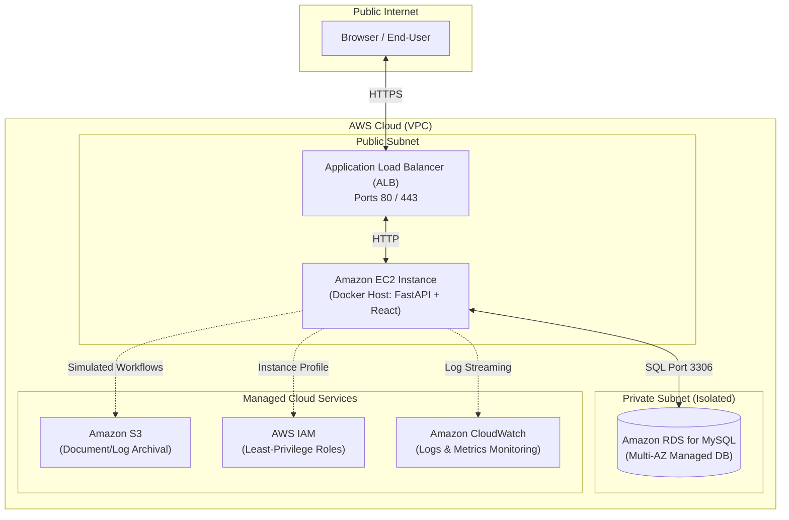

# AWS Cloud Architecture & Deployment Guide

This document explains how the **Cloud-Based IT Service Request & Automation Portal** is architected for cloud deployment on Amazon Web Services (AWS).

> [!IMPORTANT]
> **Implementation Status Policy**:
> We strictly document what is currently running versus what is planned. Zero paid cloud resources are created today.
> * **CURRENTLY IMPLEMENTED**: Actually working on the local machine today.
> * **SIMULATED**: Modeled in Python logic generating mock identifiers, but not calling AWS APIs.
> * **PLANNED**: Architecturally designed for future AWS cloud deployment.

---

## 1. Proposed Cloud Architecture Topology

---

## 2. AWS Services Breakdown

### Amazon EC2 (Elastic Compute Cloud)
* **What is it?**: Scalable virtual computing servers in the AWS cloud.
* **Why would our project use it?**: To host our containerized FastAPI backend and React frontend applications.
* **What would it replace?**: Replaces running `uvicorn` and `npm` locally on your Windows developer laptop.
* **What would happen in production?**: An Ubuntu Linux EC2 instance inside an AWS VPC runs Docker Compose, auto-restarting services if they crash and scaling horizontally behind a load balancer.
* **Status**: **PLANNED**

---

### Amazon RDS for MySQL (Relational Database Service)
* **What is it?**: A fully managed relational database service that automates database provisioning, patching, backups, and failover.
* **Why would our project use it?**: To store persistent users and service request tickets with high availability and automated nightly backups.
* **What would it replace?**: Replaces the local Windows `MySQL80` service.
* **What would happen in production?**: RDS runs in an isolated private VPC subnet, inaccessible from the public internet. Only the backend EC2 security group is permitted to connect on port 3306.
* **Status**: **PLANNED**

---

### Amazon S3 (Simple Storage Service)
* **What is it?**: Highly durable, scalable object storage designed to store and retrieve any amount of data from anywhere.
* **Why would our project use it?**: To store long-term automation execution reports, ticket attachments, and audit logs.
* **What would it replace?**: Replaces writing log files directly to local disk.
* **What would happen in production?**: When a service request is completed, the automation engine uploads the timestamped log file directly to a private S3 bucket (`s3://corp-it-portal-logs/`).
* **Status**: **SIMULATED** (The local automation engine generates mock S3 ARN identifiers such as `arn:aws:s3:::corp-it-portal-logs/2026/ticket-101.log` without calling AWS).

---

### AWS IAM (Identity and Access Management)
* **What is it?**: The security gatekeeper of AWS, controlling who or what can access specific cloud resources.
* **Why would our project use it?**: To attach an IAM Instance Profile to the EC2 server, granting it temporary credentials to write to CloudWatch and S3 without hardcoding AWS access keys in code.
* **What would it replace?**: Replaces having to store AWS access keys on the server.
* **What would happen in production?**: EC2 requests temporary security credentials automatically from the AWS metadata service.
* **Status**: **PLANNED**

---

### Amazon CloudWatch
* **What is it?**: A real-time monitoring and observability service for cloud resources and applications.
* **Why would our project use it?**: Collects stdout logs from FastAPI, tracks API error rates, and sets alarms if server CPU exceeds 80%.
* **What would it replace?**: Replaces manual inspection of terminal stdout.
* **What would happen in production?**: The AWS CloudWatch unified agent streams container logs to a CloudWatch Log Group (`/aws/it-portal/backend`), enabling instant log search and metric dashboards.
* **Status**: **PLANNED**

---

## 3. Resume & Interview Alignment

When discussing AWS in technical interviews:

> **Do NOT claim:**
> *"I provisioned and managed production AWS EC2 and RDS instances in the cloud."*

> **DO claim:**
> *"I designed the application with a cloud-ready architecture using environment-based configuration, stateless JWT authentication, and Docker containerization so it can be deployed directly onto an AWS EC2 instance connected to a private Amazon RDS MySQL database."*
