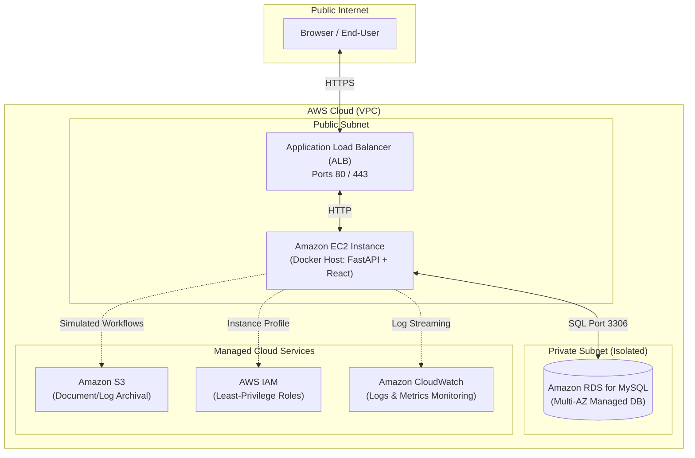

# AWS Cloud Architecture & Deployment Guide

This document explains how the **Cloud-Based IT Service Request & Automation Portal** is architected for cloud deployment on Amazon Web Services (AWS).

> [!IMPORTANT]
> **Implementation Status Policy**:
> We strictly document what is currently running versus what is planned. Zero paid cloud resources are created today.
> * **CURRENTLY IMPLEMENTED**: Actually working on the local machine today.
> * **SIMULATED**: Modeled in Python logic generating mock identifiers, but not calling AWS APIs.
> * **PLANNED**: Architecturally designed for future AWS cloud deployment.

---

## 1. Proposed Cloud Architecture Topology



---

## 2. AWS Services Breakdown

### Amazon EC2 (Elastic Compute Cloud)
* **What is it?**: Scalable virtual computing servers in the AWS cloud.
* **Why would our project use it?**: To host our containerized FastAPI backend and React frontend applications.
* **What would it replace?**: Replaces running `uvicorn` and `npm` locally on your Windows developer laptop.
* **What would happen in production?**: An Ubuntu Linux EC2 instance inside an AWS VPC runs Docker Compose, auto-restarting services if they crash and scaling horizontally behind a load balancer.
* **Status**: **PLANNED**

---

### Amazon RDS for MySQL (Relational Database Service)
* **What is it?**: A fully managed relational database service that automates database provisioning, patching, backups, and failover.
* **Why would our project use it?**: To store persistent users and service request tickets with high availability and automated nightly backups.
* **What would it replace?**: Replaces the local Windows `MySQL80` service.
* **What would happen in production?**: RDS runs in an isolated private VPC subnet, inaccessible from the public internet. Only the backend EC2 security group is permitted to connect on port 3306.
* **Status**: **PLANNED**

---

### Amazon S3 (Simple Storage Service)
* **What is it?**: Highly durable, scalable object storage designed to store and retrieve any amount of data from anywhere.
* **Why would our project use it?**: To store long-term automation execution reports, ticket attachments, and audit logs.
* **What would it replace?**: Replaces writing log files directly to local disk.
* **What would happen in production?**: When a service request is completed, the automation engine uploads the timestamped log file directly to a private S3 bucket (`s3://corp-it-portal-logs/`).
* **Status**: **SIMULATED** (The local automation engine generates mock S3 ARN identifiers such as `arn:aws:s3:::corp-it-portal-logs/2026/ticket-101.log` without calling AWS).

---

### AWS IAM (Identity and Access Management)
* **What is it?**: The security gatekeeper of AWS, controlling who or what can access specific cloud resources.
* **Why would our project use it?**: To attach an IAM Instance Profile to the EC2 server, granting it temporary credentials to write to CloudWatch and S3 without hardcoding AWS access keys in code.
* **What would it replace?**: Replaces having to store AWS access keys on the server.
* **What would happen in production?**: EC2 requests temporary security credentials automatically from the AWS metadata service.
* **Status**: **PLANNED**

---

### Amazon CloudWatch
* **What is it?**: A real-time monitoring and observability service for cloud resources and applications.
* **Why would our project use it?**: Collects stdout logs from FastAPI, tracks API error rates, and sets alarms if server CPU exceeds 80%.
* **What would it replace?**: Replaces manual inspection of terminal stdout.
* **What would happen in production?**: The AWS CloudWatch unified agent streams container logs to a CloudWatch Log Group (`/aws/it-portal/backend`), enabling instant log search and metric dashboards.
* **Status**: **PLANNED**

---

## 3. Resume & Interview Alignment

When discussing AWS in technical interviews:

> **Do NOT claim:**
> *"I provisioned and managed production AWS EC2 and RDS instances in the cloud."*

> **DO claim:**
> *"I designed the application with a cloud-ready architecture using environment-based configuration, stateless JWT authentication, and Docker containerization so it can be deployed directly onto an AWS EC2 instance connected to a private Amazon RDS MySQL database."*

---

## 4. Live AWS EC2 Step-by-Step Deployment Guide

Follow this guide to deploy your live multi-container application on an AWS EC2 instance using your **AWS Free Tier** and **\$100 Credit**.

### Cost Breakdown & Safeguards
* **EC2 Instance**: `t2.micro` is **100% Free Tier eligible** (750 hours/month free for 12 months). If using `t3.small` (2 GB RAM for snappier builds), it costs \~\$15/month and is easily covered by your \$100 credit for \~6.5 months.
* **Storage**: 20 GB gp3 root volume (Free Tier includes up to 30 GB SSD storage).
* **Data Transfer**: First 100 GB/month outbound is free.
* **Total Expected Monthly Cost**: **\$0.00** (under Free Tier) or \~\$15 deducted from your \$100 credit if choosing `t3.small`.

---

### Step 1: Push Code to GitHub
1. Initialize or check your local Git repository on branch `main`:
   ```bash
   git branch -M main
   ```
2. Create a new repository on [GitHub](https://github.com/new) (e.g. `cloud-it-service-portal`).
3. Add the remote and push your code:
   ```bash
   git remote add origin https://github.com/<YOUR-USERNAME>/cloud-it-service-portal.git
   git push -u origin main
   ```

---

### Step 2: Launch an AWS EC2 Instance
1. Sign in to the **[AWS Management Console](https://console.aws.amazon.com/)**.
2. Select your nearest region (e.g. `us-east-1` N. Virginia or `ap-south-1` Mumbai) in the top-right corner.
3. Search for **EC2** and click **Launch instance**.
4. Configure the instance:
   * **Name**: `cloud-it-service-portal`
   * **Application and OS Image (AMI)**: **Ubuntu Server 24.04 LTS (HVM)**, SSD Volume Type (64-bit x86). *Free tier eligible*.
   * **Instance Type**:
     * Option A (100% Free Tier): **`t2.micro`** (1 vCPU, 1 GiB RAM).
     * Option B (Uses \$100 Credit, faster build): **`t3.small`** (2 vCPU, 2 GiB RAM).
   * **Key pair (login)**: Click **Create new key pair**:
     * Key pair name: `cloud-portal-key`
     * Key pair type: `RSA`
     * Private key file format: `.pem` (OpenSSH)
     * Click **Create key pair** and save the downloaded `.pem` file to your computer.
   * **Network settings** (Firewall / Security Group):
     * Click **Edit** network settings.
     * Inbound security group rules:
       1. **SSH** | Port 22 | Source: Anywhere (`0.0.0.0/0`) or My IP
       2. **HTTP** | Port 80 | Source: Anywhere (`0.0.0.0/0`) — *React Web App*
       3. **Custom TCP** | Port 3000 | Source: Anywhere (`0.0.0.0/0`) — *Alternative Web Port*
       4. **Custom TCP** | Port 8000 | Source: Anywhere (`0.0.0.0/0`) — *FastAPI Swagger Docs*
   * **Configure storage**:
     * Set Size to **`20` GiB** `gp3` (within the 30 GiB free limit).
5. Review the summary and click **Launch instance**.
6. Wait 1–2 minutes until the instance state shows **Running**. Copy your **Public IPv4 address** (e.g. `54.210.12.34`).

---

### Step 3: Connect to your EC2 Instance
You can connect using either method:

#### Method A: EC2 Instance Connect (1-Click in Browser - Easiest)
1. In the EC2 Console, select your instance checkbox.
2. Click **Connect** in the top action bar.
3. Keep **EC2 Instance Connect** selected and click **Connect**. A terminal window opens directly in your browser.

#### Method B: SSH from Windows Terminal / PowerShell
Open PowerShell on your computer and run:
```powershell
# Optional: Set read-only permission on your downloaded key
icacls "path\to\cloud-portal-key.pem" /inheritance:r /grant:r "$($env:USERNAME):(R)"

# Connect to EC2
ssh -i "path\to\cloud-portal-key.pem" ubuntu@<YOUR-EC2-PUBLIC-IP>
```

---

### Step 4: Configure Server Environment on EC2
Once connected inside the Ubuntu terminal, run the following commands:

1. **Update Ubuntu packages**:
   ```bash
   sudo apt update && sudo apt upgrade -y
   ```

2. **Set up 2 GB Swap Memory** *(Essential on `t2.micro` to prevent memory exhaustion during Docker builds & MySQL startup)*:
   ```bash
   sudo fallocate -l 2G /swapfile
   sudo chmod 600 /swapfile
   sudo mkswap /swapfile
   sudo swapon /swapfile
   echo '/swapfile none swap sw 0 0' | sudo tee -a /etc/fstab
   ```

3. **Install Docker Engine & Docker Compose**:
   ```bash
   curl -fsSL https://get.docker.com -o get-docker.sh
   sudo sh get-docker.sh
   sudo usermod -aG docker ubuntu
   newgrp docker
   ```
   *Verify installation:*
   ```bash
   docker --version
   docker compose version
   ```

4. **Install Git**:
   ```bash
   sudo apt install -y git
   ```

---

### Step 5: Clone & Deploy the Application
1. **Clone the repository**:
   ```bash
   git clone https://github.com/<YOUR-USERNAME>/cloud-it-service-portal.git
   cd cloud-it-service-portal
   ```

2. **Build and start all services via Docker Compose**:
   ```bash
   docker compose up -d --build
   ```
   *This automatically builds the React SPA production bundle, compiles the FastAPI backend image, and starts MySQL with health checking.*

3. **Verify running containers**:
   ```bash
   docker compose ps
   ```
   You should see:
   * `cloud_it_mysql` (Up - healthy)
   * `cloud_it_backend` (Up)
   * `cloud_it_frontend` (Up)

4. **View live logs (optional)**:
   ```bash
   docker compose logs -f backend
   ```
   *(Press Ctrl+C to exit log streaming)*

---

### Step 6: Test & Verify Live Deployment
Open your browser and navigate to:
* **Web Application**: `http://<YOUR-EC2-PUBLIC-IP>` (or `http://<YOUR-EC2-PUBLIC-IP>:3000`)
* **Interactive Swagger API Docs**: `http://<YOUR-EC2-PUBLIC-IP>/docs` (or `http://<YOUR-EC2-PUBLIC-IP>:8000/docs`)

**Testing the Live System**:
1. Open `http://<YOUR-EC2-PUBLIC-IP>`.
2. Toggle to **Create Account** (or click **Fill Employee** then click **Register**).
3. Submit a service request (e.g. AWS EC2 Virtual Machine).
4. Register the administrator (`admin@company.com`).
5. Click **Execute Automation** and observe the live Cloud Terminal rendering mock AWS identifiers!

---

### Step 7: Managing Costs & Stopping the Instance
* **When you are done testing/demoing**:
  * In the EC2 Console: Select your instance -> **Instance state** -> **Stop instance**.
  * When stopped, compute charges are **\$0/hour**.
* **When you want to demo it again**:
  * Select instance -> **Instance state** -> **Start instance**.
  * Note: The public IP will change upon restart (unless an Elastic IP is attached). Docker containers will automatically restart due to `restart: always`.

