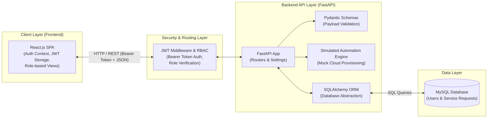
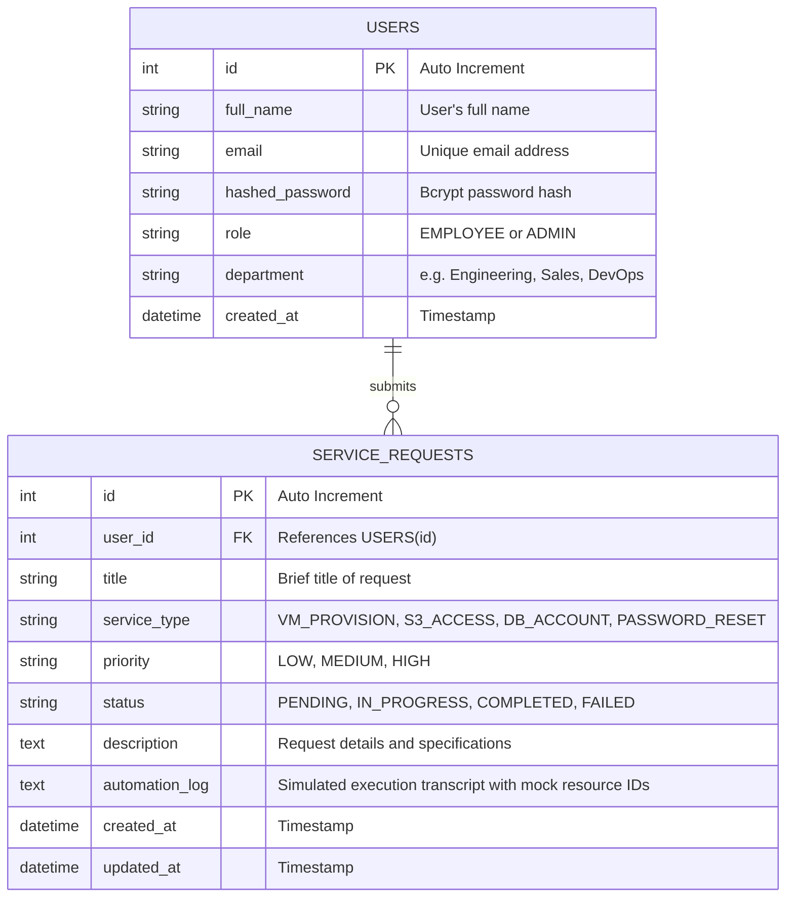
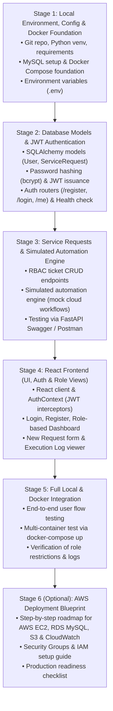

# Cloud-Based IT Service Request & Automation Portal
## Architectural Blueprint & Incremental Implementation Plan

---

### 1. High-Level Architecture

The project is structured as a decoupled, container-ready client-server application. It runs locally via Docker Compose or native virtual environment, with authentication, role-based authorization, and an explicitly simulated IT automation engine.



#### Request & Security Flow
1. **Authentication**: Users register and log in (`POST /api/auth/login`). FastAPI verifies password hashes using `bcrypt` and returns a signed JSON Web Token (JWT) containing the user ID and role (`EMPLOYEE` or `ADMIN`).
2. **Authorized Actions**: React attaches the JWT in the `Authorization: Bearer <token>` header for subsequent requests.
3. **Role-Based Authorization (RBAC)**:
   - **`EMPLOYEE`**: Can create service requests, view their own requests, and inspect execution logs.
   - **`ADMIN`**: Can view all requests across the organization, trigger automated fulfillment, and manage users.
4. **Simulated Automation Engine**:
   - For now, automation workflows are **explicitly simulated** (mock EC2 provisioning, mock S3 bucket access grant, mock DB credentials creation, mock password reset).
   - The engine generates realistic simulated execution transcripts, timestamps, and mock resource IDs (e.g., `i-0b4e28a9f3c1`, `arn:aws:s3:::corp-data-bucket-789`) without making external API calls or incurring costs.
5. **Persistence**: State transitions (`PENDING` -> `IN_PROGRESS` -> `COMPLETED`/`FAILED`) and execution logs are committed to MySQL via SQLAlchemy.

---

### 2. Project Folder Structure

A modular, production-ready structure supporting both local development and containerization:

```text
cloud-it-service-portal/
├── backend/
│   ├── app/
│   │   ├── __init__.py
│   │   ├── main.py              # FastAPI app creation, CORS, router mounting
│   │   ├── config.py            # Environment settings via Pydantic BaseSettings
│   │   ├── database.py          # SQLAlchemy engine, session maker, Base
│   │   ├── security.py          # Password hashing (bcrypt) & JWT token handlers
│   │   ├── dependencies.py      # Auth guards (get_current_user, require_admin)
│   │   ├── models/              # SQLAlchemy database models
│   │   │   ├── __init__.py
│   │   │   ├── user.py          # User entity with roles
│   │   │   └── service_request.py # ServiceRequest entity with automation logs
│   │   ├── schemas/             # Pydantic schemas (validation & serialization)
│   │   │   ├── __init__.py
│   │   │   ├── user.py          # UserCreate, UserResponse, Token
│   │   │   └── service_request.py # RequestCreate, RequestResponse
│   │   ├── routers/             # API route controllers
│   │   │   ├── __init__.py
│   │   │   ├── auth.py          # Register, Login, Me endpoints
│   │   │   ├── users.py         # User management (Admin only)
│   │   │   └── requests.py      # Ticket lifecycle & automation triggers
│   │   └── services/            # Business & Automation logic
│   │       ├── __init__.py
│   │       └── automation.py    # Simulated IT workflow execution engine
│   ├── tests/                   # Backend unit/API tests
│   ├── .env.example             # Backend environment variable template
│   ├── requirements.txt         # Python dependencies
│   └── Dockerfile               # Backend container definition
├── frontend/
│   ├── public/
│   │   └── index.html
│   ├── src/
│   │   ├── api/
│   │   │   └── client.js        # Axios/Fetch client with JWT interceptor
│   │   ├── context/
│   │   │   └── AuthContext.jsx  # React context for user state and token management
│   │   ├── components/          # Reusable UI elements
│   │   │   ├── Navbar.jsx
│   │   │   ├── ProtectedRoute.jsx # Role-based route guard
│   │   │   ├── RequestCard.jsx
│   │   │   └── StatusBadge.jsx
│   │   ├── pages/               # Views
│   │   │   ├── Login.jsx
│   │   │   ├── Register.jsx
│   │   │   ├── Dashboard.jsx    # Metrics and request list (filtered by role)
│   │   │   ├── NewRequest.jsx   # Request submission form
│   │   │   └── RequestDetail.jsx# Ticket details & simulated execution log viewer
│   │   ├── App.jsx
│   │   ├── App.css
│   │   └── index.js
│   ├── .env.example             # Frontend environment variable template
│   ├── package.json
│   └── Dockerfile               # Frontend container definition (Nginx or Node)
├── docker-compose.yml           # Multi-container orchestration (DB, API, Frontend)
├── .gitignore
└── README.md                    # Project documentation
```

---

### 3. Database ER Design

The database design implements strict relational integrity with two core entities:



#### Schema Highlights:
- **`USERS`**:
  - `hashed_password`: Plaintext passwords are never stored. Passwords are salted and hashed using `bcrypt`.
  - `role`: Enum/String supporting `EMPLOYEE` and `ADMIN` for access control.
- **`SERVICE_REQUESTS`**:
  - `user_id`: Foreign key enforcing ownership.
  - `automation_log`: Detailed simulated execution logs, including simulated AWS response codes and mock resource identifiers.

---

### 4. API Endpoint Specification

All endpoints are versioned under `/api` and enforce JWT authentication via the `Authorization: Bearer <token>` header, except for public authentication and health routes.

| Method | Endpoint | Access Level | Description |
| :--- | :--- | :--- | :--- |
| `GET` | `/api/health` | Public | Healthcheck verifying API status and database connectivity. |
| `POST` | `/api/auth/register` | Public | Register a new user (defaults to `EMPLOYEE` role). |
| `POST` | `/api/auth/login` | Public | Authenticate credentials; returns JWT access token. |
| `GET` | `/api/auth/me` | Authenticated | Return profile of the currently logged-in user. |
| `GET` | `/api/users` | `ADMIN` only | List all registered users and their roles. |
| `POST` | `/api/requests` | Authenticated | Create a service request. Owner ID extracted from JWT. |
| `GET` | `/api/requests` | Authenticated | List requests. `EMPLOYEE` views own; `ADMIN` views all. Filterable by `status`. |
| `GET` | `/api/requests/{id}` | Authenticated | Get request details. Restricted to owner or `ADMIN`. |
| `POST` | `/api/requests/{id}/execute` | `ADMIN` only | Trigger the simulated automation engine to fulfill the request. |
| `DELETE` | `/api/requests/{id}` | Authenticated | Cancel a request. Owner can cancel if `PENDING`; `ADMIN` can delete any. |

---

### 5. Environment-Variable Configuration

Configuration is decoupled from code and driven by environment variables using `pydantic-settings`.

#### Backend Configuration (`backend/.env`):
```ini
# Application
PROJECT_NAME="Cloud-Based IT Service Request Portal"
ENVIRONMENT="development"
DEBUG=True

# Database Configuration
DB_HOST=localhost            # Use "db" when running inside Docker Compose
DB_PORT=3306
DB_USER=it_user
DB_PASSWORD=it_password123
DB_NAME=cloud_it_portal

# Security & JWT Configuration
JWT_SECRET_KEY=change_this_to_a_secure_random_string_in_production
JWT_ALGORITHM=HS256
ACCESS_TOKEN_EXPIRE_MINUTES=60

# CORS
CORS_ORIGINS=["http://localhost:3000","http://localhost:5173"]
```

#### Frontend Configuration (`frontend/.env`):
```ini
REACT_APP_API_BASE_URL=http://localhost:8000/api
```

---

### 6. Cloud-Ready Design Practices

Rather than using generic buzzwords, this project adheres to specific, interview-verifiable cloud-ready practices:

1. **Strict Separation of Configuration and Code**:
   - All environment-dependent values (database credentials, JWT secrets, hostnames, CORS rules) are loaded from environment variables via Pydantic settings.
2. **Stateless API Tier**:
   - The FastAPI backend stores zero session state in server memory. User authentication relies on signed, verifiable JWTs stored client-side. Any backend instance can handle any incoming request.
3. **Environment Parity via Containerization**:
   - Docker and Docker Compose define identical runtime environments across local development and future EC2 deployment, preventing "works on my machine" discrepancies.
4. **Decoupled Architecture**:
   - The React client, FastAPI server, and MySQL database run in separate processes/containers, allowing each to be scaled, upgraded, or replaced independently.
5. **Observability & Health Checks**:
   - Dedicated `/api/health` endpoint verifies application liveliness and database connectivity, matching the health probe requirements of cloud load balancers and container orchestrators.
   - Structured stdout logging with timestamps and context, ready for log collection systems like AWS CloudWatch Logs.

---

### 7. Explicitly Simulated Automation Engine

The automation service (`backend/app/services/automation.py`) simulates cloud and IT infrastructure operations with high realism:

- **Simulated Actions**:
  - `VM_PROVISION`: Validates instance parameters -> logs simulated security group assignment -> generates mock AWS EC2 Instance ID (`i-0a81c72f4e3b1`) -> marks `COMPLETED`.
  - `S3_ACCESS`: Checks user department -> generates mock IAM policy grant ARN (`arn:aws:iam::123456789012:policy/DevS3Access`) -> marks `COMPLETED`.
  - `DB_ACCOUNT`: Validates DB schema name -> creates mock read-only credential -> logs completion -> marks `COMPLETED`.
  - `PASSWORD_RESET`: Generates temporary secure token -> logs audit trace -> marks `COMPLETED`.
- **Transparency**:
  - All logs generated by the engine are clearly labeled with simulated step headers (e.g., `[SIMULATED-AWS-ENGINE]`).
  - No AWS API calls (`boto3`) or cloud credentials are required locally, guaranteeing $0 cloud spend.

---

### 8. Incremental Development Stages



#### Detailed Stage Breakdown:
- **Stage 1 — Local Environment, Config & Docker Foundation**:
  - Initialize Git repository and directory layout.
  - Set up Python virtual environment, install FastAPI, Uvicorn, SQLAlchemy, PyMySQL, Pydantic, Passlib, PyJWT.
  - Create `.env.example`, `.env`, and base `docker-compose.yml`.
  - Verify local database connectivity.
- **Stage 2 — Database Models & JWT Authentication**:
  - Implement `User` model with password hashing and roles (`EMPLOYEE`, `ADMIN`).
  - Build `security.py` and FastAPI dependencies for JWT validation and RBAC guards.
  - Implement `/api/auth/register`, `/api/auth/login`, `/api/auth/me`, and `/api/health`.
- **Stage 3 — Service Requests & Simulated Automation Engine**:
  - Implement `ServiceRequest` model and Pydantic schemas.
  - Build ticket endpoints with role-based visibility (Employees see own tickets, Admins see all).
  - Implement `automation.py` to run simulated cloud provisioning workflows with realistic logs.
  - Validate endpoints using FastAPI interactive Swagger docs (`/docs`).
- **Stage 4 — React Frontend Development**:
  - Scaffold React application.
  - Implement `AuthContext` to store JWT tokens in client storage and manage login state.
  - Create UI pages: Login/Register, Dashboard with status filters, Request creation modal, and Execution log terminal viewer.
- **Stage 5 — Local & Docker Compose Integration**:
  - Test the entire application natively and via `docker compose up --build`.
  - Validate role permissions: Verify an employee cannot trigger automation or view other users' tickets, while an admin can execute workflows and view all records.
- **Stage 6 (Optional Roadmap) — AWS Deployment Blueprint**:
  - Document the exact cloud deployment steps without launching resources:
    - Provision VPC with public and private subnets.
    - Launch an EC2 instance (Ubuntu) running Docker Compose behind an Application Load Balancer.
    - Set up AWS RDS MySQL in the private subnet.
    - Configure AWS Security Groups (Port 80/443 for ALB, Port 3306 restricted to EC2).
    - Configure CloudWatch log agent for Docker container logs.
    - Provide a future migration path from simulated automation to real `boto3` AWS API calls using IAM roles.
